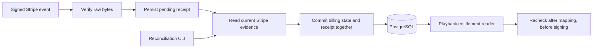

# Billing and playback: a reader's guide

**Stripe-led replacement status:** D1–D10 are approved in
[STRIPE_LED_DECISIONS.md](STRIPE_LED_DECISIONS.md). The isolated access adapter,
shared cache and terminal veto are implemented with local test evidence in
[PAID_ACCESS_IMPLEMENTATION.md](PAID_ACCESS_IMPLEMENTATION.md). No runtime cutover,
signup/frontend/owner UI changes or old-engine removal occurred. The guide below
describes the existing runtime engine, not the approved replacement policy.

The local flow is implemented and tested. Stripe supplies payment facts; this
application decides whether those facts permit playback under the approved policy.
Real Stripe validation and private media delivery remain separate prerequisites.
Service restoration is deferred.

## Follow one payment

The event is a notification. Access comes from a retrieved, finalized paid invoice,
its successful PaymentIntent/captured Charge, and its one approved recurring line.
The line supplies the original service period. Access is
`[max(serviceFrom, settledAt), serviceThrough)`: no added second, unpaid gap,
grace period or extra month on retry. Subscription status alone grants nothing.

## Where to read the code

| File | Responsibility | Start here |
| --- | --- | --- |
| `controllers/payments/controller.post.js` | Verify the original body/signature; return an acknowledgement only after processing | `webhooks` |
| `billing/evidence.js` | Validate invoice/payment relationships, tier, amounts and periods; calculate refund/dispute state | `readInvoiceEvidence`, `revocationState` |
| `billing/service.js` | Retrieve a fresh snapshot and commit it atomically | `sync` → `readSnapshot` → `applySnapshot` |
| `billing/operations.js` | Registration, one Checkout reservation, recovery and billing-aware deletion | `checkout`, `deleteAccount`, `recoverPending` |
| `billing/reader.js`, `playback/service.js` | Read local authority, then reread after mapping before signing | `readEntitlement`, `issue` |
| `billing/reconcile.js`, `scripts/reconcile-billing.js` | Inspect/repair missing updates in bounded resumable batches | `reconcileCustomer`, `reconcileBatch` |

Inside `applySnapshot`, `saveSubscriptions` applies admission/lifecycle and
`saveInvoice` retains original invoice evidence and updates revocation. Display
status is updated for compatibility, then the event receipt completes. These
writes share one database transaction. There are no provider calls inside it.

## The rules the code must preserve

| Situation | Result |
| --- | --- |
| Public track | No login or entitlement required |
| Subscriber track | Verified login plus a current, eligible persisted paid period |
| Cancellation, including immediate cancellation | Keep original unrevoked paid coverage |
| Failed renewal / `past_due` | No new time; existing paid coverage can finish |
| `incomplete`, `incomplete_expired`, `unpaid`, unknown lifecycle | Deny subscriber access |
| Full refund or lost dispute | Retain evidence and permanently revoke that invoice's period |
| Open dispute | Hold that period; absence from a later response does not clear it |
| Verified won/withdrawn dispute | Fresh payment/refund checks can restore only the original remaining period |
| Partial refund | Flag review and preserve remaining coverage unless independently revoked |
| Unexpected second ongoing subscription | Quarantine it; keep established coverage without adding its duration |
| Deletion with open/uncertain billing | Keep the account available, block new Checkout, wait for confirmed closure |
| Confirmed local deletion | Remove identity/session data; retain billing history and a tombstone |

Trials, zero-cost payments, credits, discounts, manual/out-of-band/mixed settlement,
tax/other adjustments, schedules, plan changes, collection pauses and ambiguous
lines create no new grants. Unsupported pause/trial arrangements do not extend any
previously legitimate period. Other dispute resolutions remain review. Conflicting
original invoice dates/payment IDs hold access and preserve the original row;
reconciliation must never manufacture a new end date to resolve a conflict.

## What protects retries and concurrent work

1. Persist a minimal event receipt. `pending` is not completed work.
2. Read the trusted customer binding and its revision **before** authoritative
   Stripe retrieval. Discovery reads can identify the customer first.
3. In the transaction, increment that revision only if it still matches. Save
   subscriptions, grants, compatibility display and receipt outcome together.
4. A conflict reruns the reads, up to six attempts. Duplicate invoice/line/payment
   IDs cannot create another grant. Event timestamps do not decide write order.
5. Failed persistence, provider errors, incomplete pages or exhausted limits return
   generic 5xx. Deterministic unsupported arrangements become durable review with
   no new access. Completed duplicates can acknowledge safely.

`budget.js` explicitly bounds each caller's provider requests: at most 120 calls
and 20 seconds before starting another call. The shared Stripe client bounds an
in-flight request to 10 seconds. Pagination is bounded too. Exhaustion requires
retry or smaller reconciliation batches; it does not establish absence.

Registration and Checkout persist fixed parameters and an operation UUID before
a provider POST. The UUID is the idempotency key. Existing unfinished Checkouts
are reused. A fresh retry repeats the same key; after 23 hours, only discovery of
a unique existing result permits automatic recovery. `finishCheckout` is the
single ownership/operation commit used by normal requests and repair. Recovery
never creates a new key, charges again, cancels or refunds.

## Database and integration boundaries

Migration `20261101120000_billing_evidence` adds `BillingCustomer`,
`PaidInvoiceGrant`, `StripeEventReceipt` and `BillingOperation`, and retains
Subscription history with nullable user ownership, admission and lifecycle fields.
Bindings/history survive User deletion. SQL enforces valid periods, positive
amounts, unique invoice/line/payment IDs, foreign keys, receipt outcomes and one
accepted ongoing subscription per customer. Prisma 4 cannot express all of those
CHECKs or the partial admission index.

Existing user/customer pairs backfill with unknown mode. Legacy statuses, price
placeholders and cancellation strings create **no grants or admissions**.
Inconsistent legacy ownership stops migration. No applied historical migration
was edited, and no existing/remote database migration is authorized here.

Stripe **17.5.0**, request API **2024-12-18.acacia**, Prisma **4.12.0** and Node
**24.19.0** are unchanged. Explicit server settings are `BILLING_PRICE_ID`,
`BILLING_PRODUCT_ID`, `BILLING_CURRENCY`, `BILLING_LIVEMODE` and the existing
provider/signing secrets. One shared runtime client serves billing controllers.
Only supported Acacia snapshot envelopes can process; malformed/thin/foreign-mode
or unknown-version envelopes remain review. Raw signature verification retains
the 16 KiB limit, compression rejection and timestamp checks.

The supported event list lives in `billing/service.js`. It covers paid/failed/
action-required invoices, subscription lifecycle, refunds, disputes and customer
notifications. Customer events alone cannot provision identity, delete a login
account or revive a tombstone. Provider email changes do not rebind login identity.

Playback performs no Stripe call. Its reader uses a repeatable-read database
snapshot, checks environment/ownership and returns one containing period.
Absent/expired/ineligible evidence is 403; unavailable/inconsistent authority is
503. Asset mapping and signing are still unavailable in normal runtime. The
existing two-hour URL contract remains; database revocation cannot recall issued
URLs or bytes, and provider changes can lag until an event or reconciliation.

## Verification and operations

See [test/README.md](test/README.md) for current results and reproducible commands,
[Operations.md](Operations.md) for inspection/recovery, and
[BILLING_ENTITLEMENT_DESIGN.md](BILLING_ENTITLEMENT_DESIGN.md) for the original
approved design. The same lifecycle cases run with memory storage and disposable
PostgreSQL. Stripe resources, mail and media are fake; PostgreSQL/Prisma are real.
The separate strict `NetworkError.errorCode` schema diagnostic remains failing.

Still separate: named Stripe test-mode validation of tier/mode/API/event/body-size
and financial behavior; daily reconciliation invocation and lag acceptance;
private storage/signing, legacy public-URL retirement, deployed behavior and
restoration. No real provider calls, remote SQL, uploads, infrastructure changes,
deployment, push or merge occurred. Local tests establish no live billing or
media-protection guarantee.

Official references: [Acacia invoices](https://docs.stripe.com/api/invoices/object?api-version=2024-12-18.acacia),
[PaymentIntents](https://docs.stripe.com/api/payment_intents/object?api-version=2024-12-18.acacia),
[Charges](https://docs.stripe.com/api/charges/object?api-version=2024-12-18.acacia),
[disputes](https://docs.stripe.com/api/disputes/object?api-version=2024-12-18.acacia),
[verified withdrawals](https://support.stripe.com/questions/dispute-withdrawals-faq?locale=en-GB).
